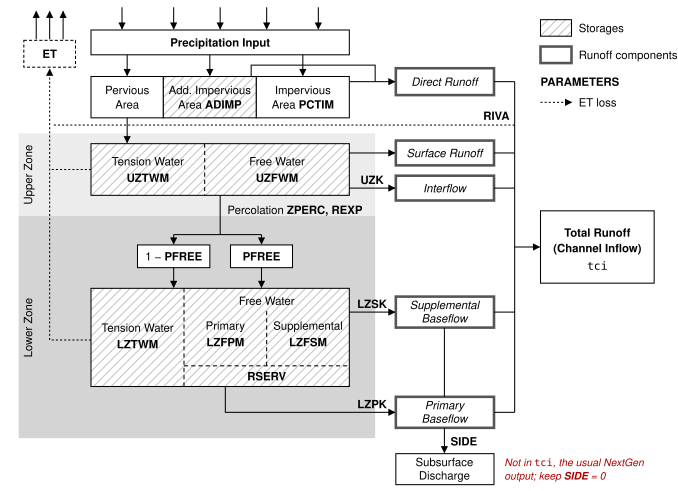

# Sac-SMA

**Description**:  A BMI enabled version of the Sacramento Soil Moisture Accounting (Sac-SMA) model.  

This version of Sac-SMA was built to run standalone as well as in the [ngen framework](https://github.com/NOAA-OWP/ngen). Both modes run the model through the same BMI interface; the standalone executable is a small driver that calls it. The difference is that the standalone build reads forcings from files and writes outputs to files, while the NextGen build compiles that file I/O out and exchanges forcings and outputs with NextGen through BMI `set_value`/`get_value`. In standalone mode, multiple hydrologic response units (HRUs) can be modeled at once. Multiple HRUs are not currently supported in the NextGen BMI: each model instance represents a single HRU, and only the first HRU in the parameter file is used.

Primary Language: Fortran


## Dependencies
- Fortran compiler
- NextGen ISO C Fortran BMI library (optional)

## Running in Standalone

The following describes how to build and run Sac-SMA as a standalone model.

Clone repository and change to project directory
```
git clone https://github.com/NOAA-OWP/sac-sma.git
cd sac-sma
```

Generate a CMake build system and directory (in the example below and those that follow, the directory is assumed to be `cmake_build` within the repo root):
```bash
# You can also include the '-DCMAKE_BUILD_TYPE=Debug' option if you want to build for debugging
cmake -B cmake_build -S .
```

Note that you may need or want to specify the Fortran compiler, done by supplying a value for the `FC` variable when you generate the build directory.  There are many reasons for that:  maybe you have multiple compilers installed, or maybe your compiler isn't installed to the standard system path or using a standard name CMake will recognize.

Regardless, if necessary just append `FC=<path_to_compiler>` to the rest of the command:
```bash
# Here we are manually telling CMake to use '/opt/local/bin/gfortran-mp-14' as the Fortran compiler,
# rather than whatever compiler it would find on its own.
FC=/opt/local/bin/gfortran-mp-14 cmake -B cmake_build -S .
```

With the build directory generated, build the stand-alone executable:
```bash
cmake --build cmake_build --target sac
```

You should now see the `cmake_build/sac` stand-alone executable. 

To run the example provided:

```
cd ../test_cases/ex1/run/
../../../cmake_build/sac namelist.bmi.HHWM8
```

## Running in [Ngen](https://github.com/NOAA-OWP/ngen)

The following are instructions for building the Sac-SMA BMI module shared library.  In particular, this is necessary to run the Sac-SMA model in the [Next Generation Water Resources Modeling Framework](https://github.com/NOAA-OWP/ngen).

As described above for stand-alone builds, clone the repo if necessary and change into the repo root directory.
```bash
git clone https://github.com/NOAA-OWP/sac-sma.git
cd sac-sma
```

Within the repo root, once again generate a CMake build directory. The shared library requires access to the NextGen ISO C Fortran BMI library.  This is an intermediate library needed for any Fortran BMI module to ensure NextGen compatibility.  It is included with ngen, in the extern/iso_c_fortran_bmi subdirectory.  

By default, CMake will look for a copy of iso_c_fortran bmi in the same directory as the sac-sma code. If you prefer, you can set the path to this subdirectory using the `ISO_C_FORTRAN_BMI_PATH` option, as follows;

> [!WARNING]
> If you created stand-alone-only build directory already, remove it first.  Don't worry:  the NextGen-supporting build directory will also support stand-alone builds.
```bash
# The same advice discussed in the stand-alone section about optionally adding 'FC=<path_to_compiler>' and/or 
# '-DCMAKE_BUILD_TYPE=Debug' applies here
cmake -B cmake_build -DISO_C_FORTRAN_BMI_PATH=/Users/rbartel/Developer/noaa/ngen/extern/iso_c_fortran_bmi -S .
```
> [!TIP]
> The directory to use for ISO_C_FORTRAN_BMI_PATH will generally be `<path_to_your_ngen_repo>/extern/iso_c_fortran_bmi`.  It is assumed that you have already cloned the NextGen repo locally.

With this done when the build directory is created, we will also have access to another build target:  `sacbmi`.   This is how we build the NextGen BMI module shared library:
```bash
cmake --build cmake_build --target sacbmi
``` 
> [!NOTE]
> You can still build the stand-alone executable as described above when you generate a build directory for NextGen builds.  You can also omit specify a target when building, in which case, CMake will build all valid build targets.
```bash
cmake --build cmake_build --target sac    # This will build the stand-alone executable, even when generating for NextGen builds
cmake --build cmake_build                 # This will build the stand-alone executable and the NextGen BMI module shared library
```
Once you build the shared library, you should see the shared library in build directory, named `cmake_build/libsacbmi.<version>.so` on Linux systems (on Mac, you will see `.dylib` rather than `.so`).  There will also be `cmake_build/libsacbmi.so` symlink pointing to the shared library file.

### Example Config
The [ngen_files/](./ngen_files) directory has a few example configurations that you can use to test running the Sac-SMA model in ngen.  Just make sure to update the path of the Sac-SMA shared library in the `library_file` parameter to point to wherever your build shared library is (you may need to do something similar for the configured PET shared library).

## Namelist

Every run is configured by a Fortran namelist file with a single `&SAC_CONTROL` group. In standalone mode the namelist path is the command-line argument (default `namelist.input` if none is given); in NextGen it is the `init_config` of the Sac-SMA formulation in the realization file. Keys and the group name are case-insensitive, keys can be in any order, and comments start with `!`. Include all 13 keys. The model sets no defaults, so a key that is left out has no defined value (gfortran typically reads it as 0 or blank). Examples: [standalone](./test_cases/ex1/run/namelist.bmi.HHWM8) and [NextGen](./ngen_files/sac-init-HHWM8.namelist.input).

Key | Type | Description
----|------|------------
main_id | string (max 20 chars) | Basin or gage label. Used to name the combined (area-weighted) output file.
n_hrus | integer | Number of HRUs to read from the parameter file. Use 1 in NextGen, where only one HRU is exposed through BMI.
forcing_root | string | Standalone: path prefix for forcing files. The file for each HRU is `<forcing_root><hru_id>.csv`.
output_root | string | Standalone: path prefix for output files. The combined output is `<output_root><main_id>.txt`.
output_hrus | integer (0/1) | Standalone: also write one output file per HRU, <output_root><hru_id>.txt. With a single HRU (n_hrus = 1) the file only gets a header, because the combined output already holds the same data.
sac_param_file | string | Path to the [parameter file](#parameters).
start_datehr | string `YYYYMMDDHH` | Date and hour of the first timestep.
end_datehr | string `YYYYMMDDHH` | Date and hour of the last timestep (inclusive).
model_timestep | integer | Timestep in seconds (e.g. 3600 for hourly, 86400 for daily).
warm_start_run | integer (0/1) | Read initial states from state files instead of starting from default states.
write_states | integer (0/1) | Write states at every timestep to state files.
sac_state_in_root | string | Path prefix for state files to read when `warm_start_run = 1`. The file for each HRU is `<sac_state_in_root><hru_id>.txt`.
sac_state_out_root | string | Path prefix for state files to write when `write_states = 1`. The file for each HRU is `<sac_state_out_root><hru_id>.txt`.

> [!IMPORTANT]
> Quote every string value, including the dates: `start_datehr = '2015100100'`, not `start_datehr = 2015100100`. The Fortran standard (since Fortran 90; section 13.11.3.3 in Fortran 2018) requires character values in namelist input to be enclosed in apostrophes or quotation marks. Earlier compilers have accepted unquoted values, but gfortran 16 stops with `Missing quote while reading item N`.

### Namelist in NextGen

NextGen supplies the forcing (configured in the realization file) and handles the outputs through BMI. `forcing_root`, `output_root` and `output_hrus` are parsed but not used in the NextGen build, so they can be set to a placeholder such as `'/dev/null'`.

The model reports its start time, end time and timestep through BMI from `start_datehr`, `end_datehr` and `model_timestep`. NextGen reads the forcing from the realization's start time regardless of `start_datehr`, so set these keys as follows:

- `start_datehr`: the realization's `start_time`. A mismatch is not detected, but the model's time labels will be wrong.
- `end_datehr`: at least one timestep after the realization's `end_time`. Any later date also works, because NextGen stops the run at its own `end_time`. Before each step NextGen checks that the step ends at or before the model's end time, so if `end_datehr` equals the realization's end, the last step fails with "exceeds model end time". Setting `allow_exceed_end_time: true` on the formulation in the realization file skips this check; the [example realization](./ngen_files/example_realization_w_pet_sac.json) does so, which is why the [example namelist](./ngen_files/sac-init-HHWM8.namelist.input) uses the realization's end time.
- `model_timestep`: the realization's `output_interval`. Different values are not supported. The model uses the timestep to convert the precipitation and PET rates to depths, and when the two differ NextGen calls BMI `update_until`, which in the current version can loop forever instead of returning an error.

A minimal NextGen namelist for a realization running hourly from `2015-10-01 00:00:00` to `2024-09-30 23:00:00`:

```fortran
&sac_control
    main_id = 'cat-511'
    n_hrus = 1
    forcing_root = '/dev/null'
    output_root = '/dev/null'
    output_hrus = 0
    sac_param_file = '/path/to/sacsma_params_cat-511.txt'
    start_datehr = '2015100100'
    end_datehr = '2024100100'   ! one timestep after the realization end_time
    model_timestep = 3600
    warm_start_run = 0
    write_states = 0
    sac_state_in_root = '/dev/null'
    sac_state_out_root = '/dev/null'
/
```

## Parameters

The table below lists the 18 lines required in the parameter file (the file named by `sac_param_file` in the [namelist](#namelist)): 2 HRU metadata lines and 16 model parameters. Each line holds a parameter name followed by one value per HRU, separated by spaces (not tabs). Lines can be in any order, but names are case-sensitive. An [example parameter file](https://github.com/NOAA-OWP/sac-sma/tree/master/test_cases/ex1/input/params) is available in the test case.

In NextGen, model parameters can also be set with `model_params` in the realization file, using the same names, which overrides the parameter file (first HRU only). [Figure 1](#fig-sac-sma-conceptual) shows where each parameter acts in the model structure. See [[2]](#ref-nws-2002) for additional details about the conceptual meaning of each parameter.

The minimum and maximum columns give suggested calibration ranges based on [[3]](#ref-anderson-2002). The model does not enforce parameter bounds. Initial values are for reference and should be based on apriori information when available [[3]](#ref-anderson-2002). The `side` and `rserv` parameters are not normally calibrated, so they have no range and their initial values are the values recommended by [[3]](#ref-anderson-2002).

> [!NOTE]
> Some studies have tested wider calibration ranges for Sac-SMA. These have not been rigorously tested in NextGen; see [[4]](#ref-newman-2015) as an example.

Parameter | Description | Units | Min | Max | Init
----------|-------------|-------|---------|---------|--------------
hru_id | Identification string for each HRU | - | - | - | -
hru_area<sup>*</sup> | Area of each HRU | km<sup>2</sup> | - | - | -
uztwm | Maximum upper zone tension water | mm | 25 | 125 | 75
uzfwm | Maximum upper zone free water | mm | 10 | 75 | 42.5
lztwm | Maximum lower zone tension water | mm | 75 | 300 | 187.5
lzfsm | Maximum lower zone free water, secondary (aka supplemental) | mm | 15 | 300 | 157.5
lzfpm | Maximum lower zone free water, primary | mm | 40 | 600 | 320
adimp | Additional "impervious" area due to saturation | fraction | 0 | 0.2 | 0.0
uzk | Upper zone depletion rate (interflow) | day<sup>-1</sup> | 0.2 | 0.5 | 0.3
lzpk | Lower zone depletion rate, primary | day<sup>-1</sup> | 0.001 | 0.015 | 0.008
lzsk | Lower zone depletion rate, secondary (aka supplemental) | day<sup>-1</sup> | 0.03 | 0.2 | 0.115
zperc | Percolation coefficient: the rate under fully dry lower zone conditions is (1 + zperc) times the saturated rate | - | 20 | 300 | 160
rexp | Percolation equation exponent | - | 1.4 | 3.5 | 2
pctim | Minimum impervious area (directly connected to the channel system) | fraction | 0 | 0.05 | 0.0
pfree | Fraction percolating directly to lower zone free water | fraction | 0 | 0.5 | 0.05
riva | Fraction of the basin that is riparian area (draws down baseflow in dry periods) | fraction | 0 | 0.2 | 0.0
side<sup>†</sup> | Ratio of non-channel (deep recharge) baseflow to channel baseflow | - | - | - | 0.0
rserv<sup>‡</sup> | Fraction of lower zone free water not transferable to the lower zone tension water | fraction | - | - | 0.3

<sup>*</sup> The area is only used to weight averaged outputs, so other units work as long as they are consistent across HRUs.

<sup>†</sup> Keep `side` at 0.0 when running in NextGen. NextGen realizations typically use `tci` as the main output. `tci` excludes non-channel baseflow (`bfncc`), so any water `side` diverts leaves the simulation.

<sup>‡</sup> `rserv` is very insensitive; 0.3 is reasonable in almost all cases [[3]](#ref-anderson-2002).

The depletion rates `uzk`, `lzpk` and `lzsk` are always per day. The model scales them to the timestep, so no unit conversion is needed when `model_timestep` changes. Calibrated values may still not transfer exactly between runs with different timesteps.

<p align="center" id="fig-sac-sma-conceptual">
  
  <br>
  <em>Figure 1. Sac-SMA conceptual model structure and parameters, adapted from <a href="#ref-van-werkhoven-2008">[5]</a>.</em>
</p>


## Getting help

If you have questions, concerns, bug reports, etc, please file an issue in this repository's Issue Tracker.

## Open source licensing info
1. [TERMS](TERMS.md)
2. [LICENSE](LICENSE)


----

## References

1. <a id="ref-burnash-1973"></a>Burnash, R.J.C., R.L. Ferral, R.A. McGuire. (1973). A generalized streamflow simulation system: Conceptual modeling for digital computers. US Department of Commerce, National Weather Service
2. <a id="ref-nws-2002"></a>National Weather Service. (2002). II.3-SAC-SMA: Conceptualization of the Sacramento Soil Moisture Accounting Model.
3. <a id="ref-anderson-2002"></a>Anderson, E.A. (2002). Calibration of conceptual hydrologic models for use in river forecasting. NOAA Technical Report, NWS 45, Hydrology Laboratory, Silver Spring, MD. https://www.weather.gov/media/owp/oh/hrl/docs/1_Anderson_CalbManual.pdf
4. <a id="ref-newman-2015"></a>Newman, A. J., Clark, M. P., Sampson, K., Wood, A., Hay, L. E., Bock, A., Viger, R. J., Blodgett, D., Brekke, L., Arnold, J. R., Hopson, T., and Duan, Q.: Development of a large-sample watershed-scale hydrometeorological data set for the contiguous USA: data set characteristics and assessment of regional variability in hydrologic model performance, Hydrol. Earth Syst. Sci., 19, 209–223, https://doi.org/10.5194/hess-19-209-2015, 2015.
5. <a id="ref-van-werkhoven-2008"></a>van Werkhoven, K., Wagener, T., Reed, P., and Tang, Y. (2008). Characterization of watershed model behavior across a hydroclimatic gradient. Water Resources Research, 44, W01429. https://doi.org/10.1029/2007WR006271
